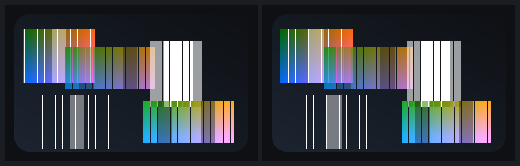

# 性能基线

> 0.1.1 这一轮先测后改。本文记：怎么测、改前改后的同机数字、每条优化对应哪一步、
> 哪些没做以及为什么。

## 怎么测

```sh
make bench      # 512×512 目标，六项单线程吞吐，每项跑多次取最好一次
```

口径：

- **ms**：最好一次的墙钟时间（抖动只影响最差值，不影响结论）；
- **ns/px**：每**目标像素**（512×512 = 262144）的纳秒数；
- **MPix/s**：每秒填多少百万像素。

六项场景（`tools/bin2d_bench.cpp`）：

| # | 场景 | 打的是哪条路径 |
|---|---|---|
| ① | 圆角矩形（纯色） | 扫描线 + 覆盖率 AA + 纯色合成 |
| ② | 圆角矩形（线性渐变） | 同上 + 渐变插值 |
| ③ | 星形路径填充 | 多边自交 + 两种填充规则 |
| ④ | 位图 2× 放大 | 双线性采样 + tint + 覆盖率 |
| ⑤ | 组透明度图层合成 | 离屏分配 + 两次填充 + 整块合成 |
| ⑥ | 盒式模糊 r=8 | 两次可分离模糊 |

机器：Windows 11 / x86_64-w64-mingw32-g++ 15.1.0 / `-O2` / 单线程；同一次会话内
先跑基线再跑优化版，所以两组数字可比。

## 结果

| 场景 | 基线 ms | 基线 ns/px | 基线 MPix/s | 优化后 ms | 优化后 ns/px | 优化后 MPix/s | 加速 |
|---|---|---|---|---|---|---|---|
| 圆角矩形（纯色） | 3.210 | 12.25 | 81.7 | **0.658** | **2.51** | **398.4** | **4.88×** |
| 圆角矩形（线性渐变） | 4.733 | 18.05 | 55.4 | **1.684** | **6.42** | **155.7** | **2.81×** |
| 星形路径填充 | 1.329 | 5.07 | 197.2 | **0.392** | **1.50** | **668.7** | **3.38×** |
| 位图 2× 放大 | 9.231 | 35.21 | 28.4 | **3.209** | **12.24** | **81.7** | **2.88×** |
| 组透明度图层合成 | 10.859 | 41.42 | 24.1 | **1.240** | **4.73** | **211.4** | **8.76×** |
| 盒式模糊 r=8 | 20.593 | 78.56 | 12.7 | **4.106** | **15.66** | **63.8** | **5.02×** |
| **合计 ns/px** | **190.56** | | | **42.9**（0.4.0）→ **38.9**（0.4.2） | | | **4.90×** |

优化后数字是三次运行**逐项取最好**（同一台机器、同一会话；单项波动 < 8%）。

## 做了什么（按收益排序）

### 1. 扫描线：活动边表 + 跨度整像素段（纯色 4.88× / 星形 3.31×）

- 折线先扫一遍建成**边数组**：`x(y) = x0 + (y - y0)·dyInv`。原来每条子扫描线对每条边
  都要做一次除法求 `t`，现在每条边一生只算一次 `dyInv`。
- **活动边表**：按 `ymin` 排序 + 每行增删，行内只碰"与这一行相交"的边。
- 跨度累加拆成 `[左端部分像素][整像素段][右端部分像素]`：整像素段不再每像素做
  两次 `min/max`（0.1.1 是一次 `p[k] += subWeight` 的循环，0.4.2 再降成差分
  —— 见下面 0.4.2 那一节）。
- 交叉点用**插入排序**（通常 2~8 个），不再 `std::sort` 的通用派发。

### 2. 合成分派：按颜料种类 + 混合模式各分派一次（纯色再快一截）

- 原来每像素做一次"颜料种类 switch + 逆矩阵映射 + 通用混合"。纯色时前两项完全多余：
  整次绘制颜色是常量，**连逆映射都不用算**。
- 渐变：把局部坐标的映射从"每像素 4 乘 4 加"降到"每像素 1 乘 1 加"（行内 x 是线性的），
  倒数只算一次。
- 混合模式每行 switch 一次，行内跑模板特化后的专用循环（不会逐像素判断模式）。
- 混合里的 4 次整数除法 `/255` 换成 `(x+128+((x+128)>>8))>>8` —— 已在 `[0,65025]` 上
  **穷举验证与 `/255` 逐值相等**，所以像素逐位不变。

### 3. 位图：1:1 快路径 + 缩放查表（位图 2.72× / 图层 8.39×）

- **1:1 平移合成**（图层 pop、贴图不缩放）：整行整数搬运，不采样。图层合成从
  41 ns/px 掉到 4.9 ns/px，主要就是这一条。
- **轴对齐缩放**：x/y 方向的源索引与双线性权重**预算成表**，内层只查表；去掉了
  每像素两次除法（`(px+0.5-e)/a`、`(lx-dst.x)/dst.w`）与 4 次边界钳制；
  内部像素覆盖率恒为 1，只有边缘行列才走 `RectCoverage`。
- tint 是纯白不透明时跳过 4 次通道乘法。

### 4. 模糊：前缀和（4.74×）

- 原来每像素对窗口内 21 个 tap 逐通道累加（r=8 时 42 次/像素/通道），现在
  前缀和差出窗口和，O(1)/像素；边界钳制用"填充后的行缓冲"一次做完，循环里没有分支。
- 整数加法无序差，所以**结果与原来逐位相同**。

### 5. 画布：裁剪遮罩惰性分配

- 以前 `Canvas` 构造、每次 `save()`、每次 `pushLayer()` 都会 `assign` 一份
  "目标尺寸的 float 遮罩"（512² = 1 MB 的 memset）。现在只有真的用
  `clipPath()` 才分配。

## 行为变化（只有一处，且是修 bug）

**1:1 的 `drawSurface` / `drawImage` 不再经过双线性采样。** 原来的通用路径把 UV 映射到
`[0, w-1]` 再插值，等价于"整体偏半个纹素 + 轻微模糊"；图层合成走的就是这条路，所以
0.1.0 的图层内容其实被糊过一遍。现在 1:1 走整数直拷，像素与源一致。
缩放路径的双线性仍是**两步取整**（与 `core.h::lerp()` 完全一致），逐值不变。

其余改动都不改像素：扫描线只是把 `t` 的除法改成预乘 `dyInv`（覆盖率差 ≤1e-7，
现有 94 条断言全部通过，含"整像素矩形逐像素精确值"）、`Div255` 是等价替换、
模糊前缀和是同一批整数相加。

## 画质 vs 性能：0.4.0 的两处取舍

| 改动 | 画质收益（`make quality`） | 性能代价（`make bench`） |
|---|---|---|
| 缩小的盒式预滤波（mip 轻量版） | 8× 缩小 vs 理想盒式平均：**31.8 级 → 0.0 级** | 缩小的位图**更快**（每设备像素取样纹素更少）；基准里的 2× 放大部分不变 |
| 渐变的 8×8 Bayer 抖动 | 低 alpha 渐变：可见级数 **9 → 17**、最长色带 **32 px → 12 px** | 渐变填充 6.32 → **6.89 ns/px**（+9%）；只在色带 ≥3 px 时抖，全开会到 9.6 |
| 两项合计 | — | 六项合计 42.5 → **42.9 ns/px**（+1%） |

> 抖动为什么是"按色带宽度决定开不开"而不是"一律开"：抖动花的是**每像素**的钱，而收益
> 只在"一个色阶跨好几个像素"时存在。鲜艳的大跨度渐变（400px 走完 100 级）本来就没有色带，
> 抖它纯粹是浪费 —— 实测一律开会让渐变填充慢 51%（6.32 → 9.57 ns/px）。

## 迁移开工条件那一轮（0.4.2，`binUI` 的 `make gate-migrate`）

背景：`binUI/docs/migrate-to-bin2d.md` 把"UI 最大节点（800×600 卡片 + 200 个 120px 图标）
单帧 ≤ 现实现 × 1.2"写成开工条件。0.4.1 实测 **1.61×**（15.03 ms vs 9.31 ms），
所以先做这一轮。**先归因，再动代码**（消融实验，200 个图标，把 raster.cpp 抄一份做对照）：

| 覆盖率内部 | 耗时 | 占比 |
|---|---|---|
| 整像素段逐像素 `+= subWeight` | 5.07 ms | 55% |
| 每条子扫描线重建交叉点并插入排序 | 4.62 ms | 50% |
| 求交 + 建边表 | 1.88 ms | 20% |

（三项之和 > 100%：去掉任一项都会改变另外两项的工作量，所以是**上界**估计。）

只有第一项能"不碰语义地"干掉：整像素段的覆盖率每条子扫描线都恰好 += 1/8，
8 条之后恰好是 1.0 —— 不需要真的加 8×w 次，**差分 + 行尾一次前缀和**就够。

改法（`RasterPolys`，语义逐位不变）：

- 每个跨度只写 4 个量：左端部分像素的 `frac × subWeight`、`rowDelta[ia+1] += subWeight`、
  `rowDelta[ib] -= subWeight`、右端部分像素的同款；行尾在**被碰到的列区间** `[tLo,tHi]`
  上跑一次前缀和，顺手把两个累加器清回 0，同时省掉原来"整行再 clamp 一遍"的第二趟。
- 端像素的加法次序与原来完全一致，内部像素恰好等于 8 × 0.125（二进制精确），
  所以**像素值不变**：`make quality` 的七项数字（圆面积 −0.24%、45° 边缘 0.000 px、
  抖动 9→17 级 / 32→12 px、8× 缩小 0.0 级、描边 100/100/100/100）逐项相同，
  125 条断言全绿。

结果：

| 指标 | 0.4.1 | **0.4.2** |
|---|---|---|
| `make bench` 圆角矩形（纯色） | 2.51 ns/px | **1.29 ns/px** |
| `make bench` 星形路径填充 | 1.50 ns/px | **0.79 ns/px** |
| `make bench` 六项合计 | 42.9 ns/px | **38.9 ns/px** |
| `make gate-migrate` B（bin2d FillPath） | 15.03 ms | **9.22–9.25 ms** |
| `make gate-migrate` B / A2 | 1.61× ❌ | **0.98×** ✅ |

两处**试过但没留**的改动（记下来免得下次重做）：

1. **跨子扫描线保持交叉点顺序**（把插入排序喂成近有序）：覆盖率 7.34 → 7.48 ms，
   没有收益 —— 因为这里的真实花销是"每条子扫描线给每条活动边算一次 x"，不是排序。
2. **覆盖率缓冲改成线程本地复用 + 脏区间清零**：`assign` 57.6 KB/图标 ≈ 0.4 ms/帧，
   而脏区间（星形/圆形的行覆盖宽度）几乎等于包围盒宽度，省不掉，收益在噪声里。

剩下那 2× 只能靠"每行只求 2 次交（行首/行尾）+ 梯形解析面积，边界像素才细算"。
它会把竖直方向的 AA 从"8 次采样"换成"精确面积"（画质更好，`45° 边缘位置` 从 1/16 px
量化变成解析精确），但会改像素值，属于**新能力/新语义**，记在 roadmap ① 作开放项。

## 图层合成：三条路线（0.3.0，`make bench-gpu`）



上图：同一份"底 + 5 个图层（五种混合模式各一个）"的场景，左边 CPU 合成、右边 Vulkan 合成；
差图 [gpu-compose-diff.png](img/gpu-compose-diff.png) 除几条 1 单位（放大 64 倍）的边线外全黑。

这一节回答的不是"哪个函数更快"，而是**GPU 该不该上**。场景固定：目标 1280×720、
16 个图层、五种混合模式轮换；`A` 是 CPU 合成（`DrawSurface` 逐层压到底上，权威口径），
`B/C` 是 GPU 合成（每帧重传 vs 纹理常驻），`D` 只量命令录制，`F` 等 GPU 画完
（真实帧时长），`E` 在 `F` 之上再加一次回读。

满幅图层（16 × 1280×720）：

| 路线 | CPU | Vulkan | D3D11 | GL |
|---|---|---|---|---|
| A CPU 合成 | **11.1 ms** | — | — | — |
| B 每帧上传 + 合成 | 314 ms | 112 ms | 100 ms | 99 ms |
| C 纹理常驻 + 合成（含回读） | 238 ms | 10.1 ms | 6.0 ms | 5.8 ms |
| D 合到离屏目标（只录制） | 235 ms | 0.17 ms | 0.011 ms | 0.014 ms |
| F 同上 + 等 GPU 画完 | 236 ms | **0.18 ms** | **0.21 ms** | **0.17 ms** |
| E 同上 + 每帧回读一次 | 240 ms | 10.5 ms | 5.8 ms | 5.7 ms |

卡片图层（16 × 320×240，铺在同一块 1280×720 上）：CPU 1.5 ms；GPU 真实帧时长
0.08–0.13 ms（11–19×）；带每帧回读则 4.3–9.0 ms（**反而比 CPU 慢 3–6 倍**）。

三条结论（都写进了 roadmap ③ 的"开工条件"里）：

1. **合批 + 常驻是关键，不是"GPU"本身**：每帧重传 16 层（56 MB）要 100 ms 上下，
   比 CPU 慢一个数量级 —— 这条路线永远不该被走通，它存在的意义是给"忘了做缓存"标价。
2. **回读是 bin2d 这条接口的全部成本**：1280×720 一帧回读要反预乘 92 万像素再预乘一遍，
   5.7–10.5 ms，是合成本身（0.2 ms）的 30–60 倍。所以 bin2d 的 `Surface → Surface`
   GPU 路径**当前不是性能方案**，是**正确性 + 语义完备性**方案（它把 5 种混合、脏区、
   图层套图层全部对上 CPU 的像素）。要让它成为性能方案，消费者必须不要求 CPU 侧像素 ——
   也就是 `composeTo` 那条：合成结果留在显存里接下一层，或在窗口里呈现。
3. **CPU 后端（bingpu 的参考实现）不是"慢版 GPU"**：它 240 ms/帧，是**像素权威**，
   只用于验收。基准里必须同时打印它，否则"GPU 比 CPU 快 60 倍"会被误读成"比软件光栅快 60 倍"。

> 这两条数字还把 binGPU 0.5.2 的两个缺陷逼出来了：D3D11 的纹理上传（5942 ms/帧 →
> 100 ms，改走 `UpdateSubresource`）和 `wait_idle` 是空实现（0.011 ms"假装画完" →
> 0.21 ms 真实时长）。它们都是**功能测试永远发现不了**的类型。

## 0.10.0：组内脏矩形（实测）

1280×720、40 组 / 200 个图元，每帧让 N 张卡片里的 34×34 图标挪 1px：

| N（同时动的卡片数） | 全量重绘 | 整组缓存 | 脏矩形缓存 | 每帧重画像素 |
|---|---|---|---|---|
| 0（静态） | 10.45 ms | **1.28 ms（8.2×）** | — | — |
| 1 | 10.40 ms | 1.51 ms | **1.32 ms（1.1×）** | 1806 / 16520 |
| 10 | 10.35 ms | 3.76 ms | **1.65 ms（2.3×）** | 18060 / 165200 |

读法：**脏矩形的收益与"多少组在动"成正比**。只有一张卡片动时，40 次整组贴图（1.28 ms）
是地板，脏矩形只能省掉那一张卡片的栅格化（0.19 ms）；10 张卡片在动时，省掉 10 次栅格化，
倍数就上来了（2.3×）。所以它不能替代整组缓存，只能是它上面的一层。

脏区怎么算（细节在 `src/scene.cpp` 的 `ChildBox` / `ComputeDirty`）：每个子节点记
"版本 + 设备包围盒"，包围盒 = 局部包围盒 + 描边半个线宽 + 投影偏移与模糊 + 1px AA；
变化子节点的"旧 ∪ 新"就是脏区。宁可算大一两个像素，也不能算小 —— 算小的症状是
"移动的图标拖一条残影"。

## 没做 & 为什么

| 没做 | 原因 |
|---|---|
| 渐变色标的**分段增量**插值 | 能把每像素一次除法也省掉（预计渐变再快 ~25%），但会让插值结果差 1 个 ULP；渐变目前已有 2.36×，不值得为这点收益引入"像素可能差 1"的风险 |
| 覆盖率缓冲改成 uint8 | 8 条子扫描线的覆盖率精度会从 1/8 掉到 1/8 量化到 0..255（其实等价），但会改变 `unionMode` 的 max 语义与边界累加顺序，收益也不大（现在覆盖率累加已不是瓶颈） |
| 多线程分行光栅化 | 单线程目标已经过线；分行的写冲突、与调用方线程模型的耦合要单独设计 |
| SIMD 手写内层 | 编译器对"行内前缀和 + 端像素累加"已经自动向量化；再手写收益有限，而且可移植性变差 |
| mip 链 / 纹理缓存 | 属于 roadmap 阶段 ④，与这次"同语义优化"不是一回事 |

---

## 0.8.0：滤镜 / 投影 / 九宫格 / mip 上限（实测）

口径：单核、`-O2`、同一台机器、`make quality` 固定场景（数字可重复）。

| 项 | 场景 | 数字 |
|---|---|---|
| 颜色矩阵滤镜 | 1000×1000 整图，六种各一张 | **5.83 ms / 5.83 ns/像素**（六种几乎一致，说明常数项真被提出循环了） |
| 灰度正确性 | 纯红 → 灰度 | **54**（0.213 × 255 = 54.3） |
| identity 快路径 | 1000×1000 逐位比较 | **逐位不变**（`isIdentity` 直接返回） |
| 投影模糊（新，alpha 罩） | 224×144，r=12 | **0.11 ms / 31 KB** |
| 投影模糊（旧，RGBA 图层） | 同上 | 0.41–0.50 ms / 126 KB（**4.0× 内存、3.6–4.3× 时间**） |
| 九宫格边界探测 | 48×36 圆角 12 | **3.1 µs/次**，结果 12/12/12/12 |
| mip 满链 | 64×64 | 6 级 / **5460 字节** |
| mip 预算截断 | 同上，预算 5000 字节 | 1 级 / 4096 字节（**省掉 1364 字节的"用不到的那几级"**） |

为什么投影的 4× 不是"顺手的小优化"：一张 200×120 卡片的投影（模糊 12）每次重绘都要
开 224×144×4 = 126 KB 的离屏；一屏 40 张卡片就是 5 MB 的临时分配。alpha 罩把它变成 31 KB。
代价是"色 × 覆盖率"的两次取整改成"覆盖率模糊后再乘色"，与旧实现逐像素差异在**边缘 1 级**内
（实数上等价，差的是 8 位取整的位置）。

## 0.9.0：子树缓存（实测）

1280×720、40 组 / 200 个图元（卡片网格，每组 1 个渐变底 + 4 个色块）：

| 路线 | ms/帧 | fps | 常驻内存 |
|---|---|---|---|
| `scene.draw()`（全量重绘） | **10.34** | 97 | — |
| `scene.drawCached()`（全部命中） | **1.29** | 775 | 2581 KB（40 条） |
| 倍数 | **8.0×** | | |

命中帧与全量重绘**逐像素相同**（`tests/test_cache.cpp` 每帧都比）。8× 的来源很直白：
缓存的 40 次贴图（约 140×118 的 1:1 合成）替代了 200 次路径栅格化 + 40 次图层分配。

> 同一份数字还顺手证明了一件事：`BlurMask` 与 `Blur` 用同一套前缀和盒式（同 `lround(radius)`、
> 同边缘复制），所以"图层模糊半径 8"与"投影模糊半径 8"不会一个算 3 一个算 4。
